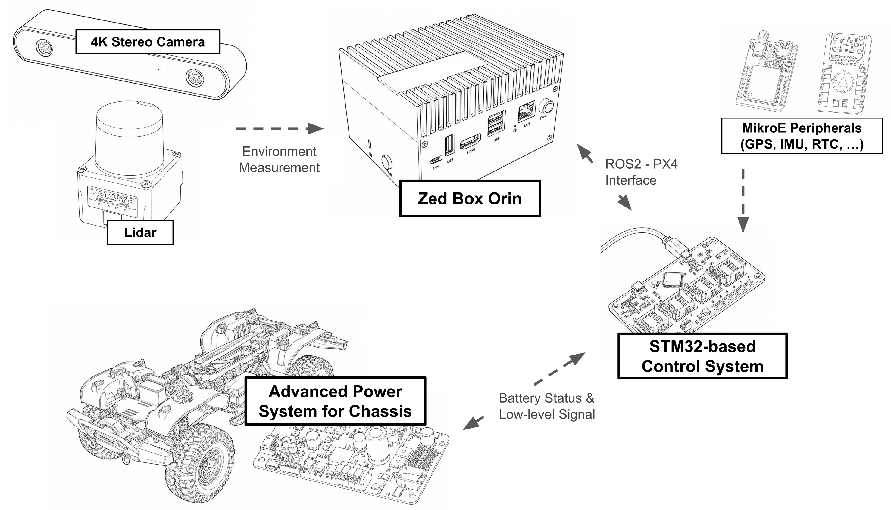

# Introduction

In this tutorial, we will introduce the SVEA hardware and software, and discuss some of the organization around the SVEA software stack. This documentation covers the updated ROS 2 implementation with the new rosonic framework.

## Hardware



As described in the diagram above, the ZED Box Orin is the main computer where all sensor data goes and where all high-level decision+control is made. The system now runs ROS2 Jazzy on Ubuntu 22.04.

The original RC remote still works to control the chassis, with some additional features added on. In particular, in addition to the RC remote's standard features, we have also added an override to the RC remote. By putting the metal switch on top(SWB) of the remote into the most forward position, the Teensy will start ignoring any actuation commands from ROS nodes and **only listen to the RC remote**. Thus it's a good idea to always keep the remote around in case you need to stop the vehicle from doing something unsafe.

## Low-Level Interface (LLI)

To interface with the vehicle chassis, the main computer communicates with the STM32F7 board, which is connected to and manages the Power Management Board(PMB). 

The low-level interface provides control over:

- **Steering**: Int8 values map into from -127 to 127, corresponding to approximately ±40 degrees
- **Velocity**: Integer values from -127 to 127, corresponding to max speed forward/backward
- **High Gear**: Boolean flag for transmission gear selection
- **Differential Lock**: Boolean flag for front/rear differential control

Press SWA to switch between High/Low Gear. The actual velocity range depends on the gear setting:

- **Low Gear (gear=0)**: Approximately ±1.7 m/s
- **High Gear (gear=1)**: Approximately ±3.6 m/s

These values also depend on battery charge and other factors.

## Software

In general, many of the basic functions needed on the SVEA platform have convenient Python interfaces. You can see them in **svea_core/svea_core/**.

For the SVEA platform's library, we have focused on creating clean, declarative Python interface objects using our new rosonic framework. The rosonic framework provides a modern approach to ROS 2 development that addresses many common pain points:

### Rosonic Framework

Rosonic is a declarative ROS 2 framework that simplifies node creation and resource management:

```python
import svea_core.rosonic as rx
from std_msgs.msg import String

class MyNode(rx.Node):
    # Declare parameters, publishers, subscribers as class attributes
    my_param = rx.Parameter('default_value')
    my_pub = rx.Publisher(String, 'my_topic')
    
    @rx.Subscriber(String, 'input_topic')
    def handle_message(self, msg):
        # Handle incoming messages
        pass
    
    @rx.Timer(1.0)  # 1 Hz timer
    def periodic_task(self):
        # Periodic execution
        pass
    
    def on_startup(self):
        # Initialization code
        pass

if __name__ == "__main__":
    MyNode.main()
```

## Development Workflow

The modern SVEA development workflow emphasizes:

1. **Simulation First**: Develop and test in simulation before moving to hardware
2. **Modular Design**: Use interfaces and controllers as building blocks
3. **Parameter-Driven**: Configure behavior through ROS parameters
4. **Visualization**: Leverage Foxglove and custom visualization tools

## Next Steps

In the next tutorial, we will guide you through implementing a pure pursuit controller and demonstrate the complete workflow from simulation to real vehicle deployment.

## Task 1

Play around with SVEA using RC