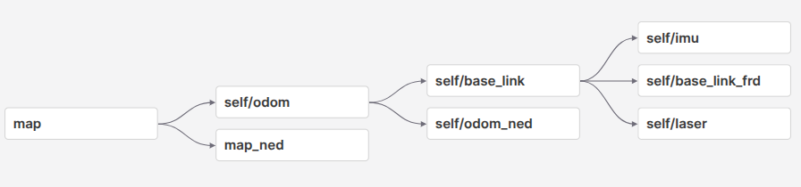
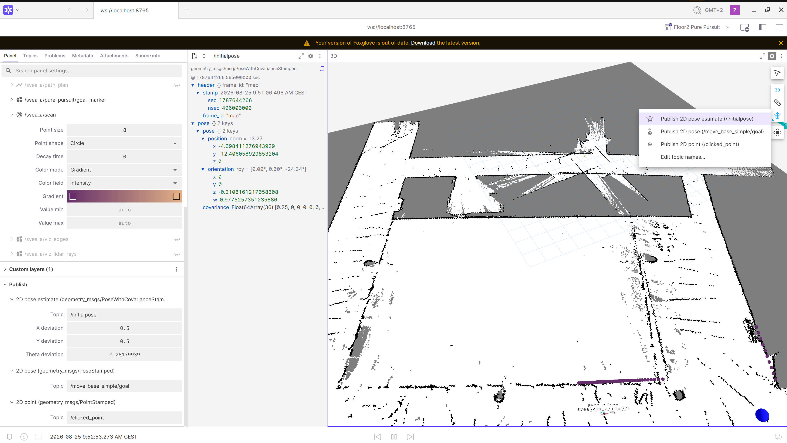

# Lidar Map Tutorial

## How to Scan a Map

### I. Preliminary Setup

1. Connect your laptop and the SVEA to the same network (campus WiFi doesn't work).

2. Open two terminals and SSH into the corresponding SVEA car from both, using `ssh user@sveax.local`. For example, to SSH into svea1:
```bash
ssh user@svea1.local
```

3. Connect the remote control to the SVEA.

4. In one terminal, `cd` into the SVEA workspace and launch the low-level interface:
```bash
util/run
ros2 launch svea_core lli.xml
```

If something starts counting down, stop the program, press RST on the STM32 board, and reconnect the remote control before launching again. If nothing counts down, press Ctrl+C and continue.

### II. Scan and Save the Map

1. Run:
```bash
ros2 launch svea_localization slam.launch.py use_two_encoders:=False use_foxglove:=True
```

2. Open Foxglove and change `localhost` to `sveax.local` (e.g. `svea1.local` for svea1) to connect. Click **Add panel** in the top right, then select **Transform Tree**. It should look like this:



Check that the vehicle's position isn't drifting in the transform tree; it's fine if only a small part of the map has appeared so far. Then use the remote control to drive the vehicle around and scan the map.

> **Open question:** how to avoid the black noise lines in the map?

#### Troubleshooting

**1. The transform tree is broken and no map appears**

*Symptoms:* the transform tree is missing `self/odom → self/base_link` or `map → self/odom`. The SLAM log keeps printing `Message Filter dropping message ... queue is full`. In `ros2 topic list`, the MAVROS topics appear as `/self/mavros/mavros/...` instead of `/self/mavros/...`.

*Cause:* MAVROS 2.16 changed how plugin topics are namespaced, so `lli.xml` (written for 2.14) now produces `/self/mavros/mavros/...`. The IMU, RC and wheel topics no longer match what the EKF and `wheel_twist` subscribe to, so the EKF never publishes `odom → base_link` and SLAM drops every scan. This happens on any car whose image was built after MAVROS 2.16 was released, even if the code is identical to a working car.

*Fix:* `docker/Dockerfile` now installs MAVROS 2.14 from the ROS 2026-06-18 snapshot and holds it, so `util/build` no longer pulls the latest version. On an affected car:
```bash
git pull
util/build
```
Then check the version inside the image:
```bash
docker run --rm --network host --entrypoint dpkg svea_template -l | grep "ros-jazzy-mavros "
```
It should print `2.14.0-...`. Do not apply the upstream fix that removes `namespace="mavros"` from `lli.xml`; that fix is for MAVROS 2.16 and breaks 2.14.

**2. The map does not update while driving(found on svea2), or the car drifts while standing still**

*Symptoms:* the map is drawn once but does not grow while you drive, or `self/base_link` moves in Foxglove while the car is stationary. `/self/odometry/local` stays at zero or moves on its own.

*Cause:* the wheel encoders are read by an ESP32-C6 peripheral MCU, which forwards them to the PX4 over UART. When the ESP32 boots and sees no encoder pulses, it can fall into **emulation mode** and send synthetic wheel data instead of real readings.

*How to check:* connect the ESP32's USB port to your computer and open its serial monitor (from the [SVEA-PX4-Autopilot-MCU-Peripheral](https://github.com/nilskiefer/SVEA-PX4-Autopilot-MCU-Peripheral) repository, with QGroundControl closed, otherwise it holds the port):
```bash
source .venv/bin/activate
pio device monitor --port /dev/serial/by-id/*Espressif* --baud 115200
```
If the log shows `mode=emulation` and `physical_left=0 physical_right=0`, the ESP32 is sending fake data.

*Fix:* with the monitor running, turn a rear wheel by hand. The ESP32 switches to `mode=real` and the counters start to follow the wheels. Then launch SLAM again.

If the log shows `mode=real` but PX4 still receives nothing, check the UART wire between the ESP32 and the PX4 board. In QGroundControl's MAVLink Console, `svea_peripheral_mcu status` should show `bytes` increasing.

3. In another SSH'd terminal, run `util/exec`, then save the map (remember to change `map_name`):
```bash
ros2 run nav2_map_server map_saver_cli -f /svea_ws/src/svea_core/maps/map_name --ros-args -p save_map_timeout:=10.0
```
You should then find the saved map in `src/svea_core/maps`.(a .pgm file and a .yaml file)

## How to Build an Obstacle Map

The scanned map uses black and grey pixels to show which areas are free and which are occupied by obstacles, but the simulator has no way of interpreting that directly. So you need to manually build an obstacle map that defines each obstacle as a polygon.

1. Connect the SVEA to a monitor via HDMI. `cd` into the SVEA workspace, but do not enter the Docker container. Open the GUI with:
```bash
python3 src/svea_core/util/obstacles_builder_gui.py
```

2. Click **Load map**, click **Add new polygon**, click on the obstacle's corner points, then click **Export** to create the obstacle map.

3. Open `svea_examples/launch/floor2.launch.py` and change `MAP_NAME` at the top of the file. The SVEA will now run using the new map.

## Check Point Coordinates in Foxglove

Right-click the coordinate icon on the right side and select **Publish 2D pose estimate (/initialpose)**. Then select a position and orientation on the map. The selected coordinates and orientation will appear on screen and be published to the `/initialpose` topic.



