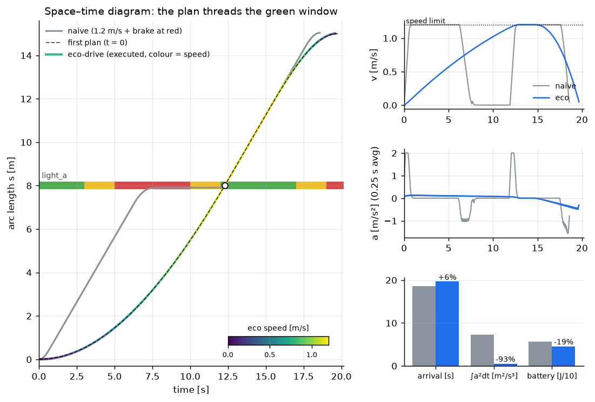
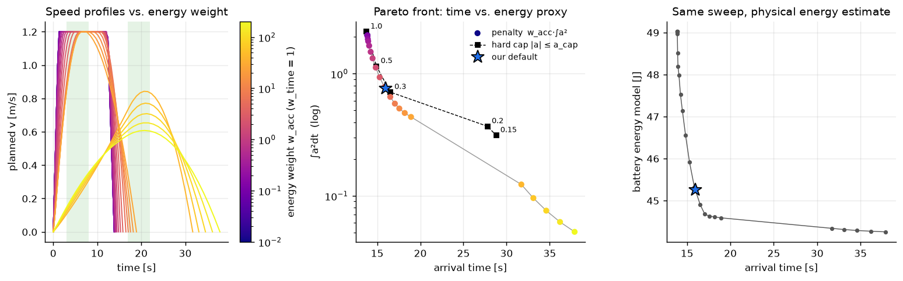
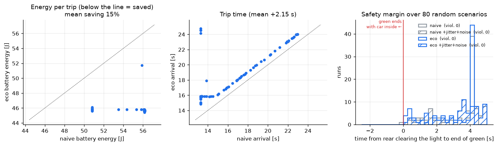
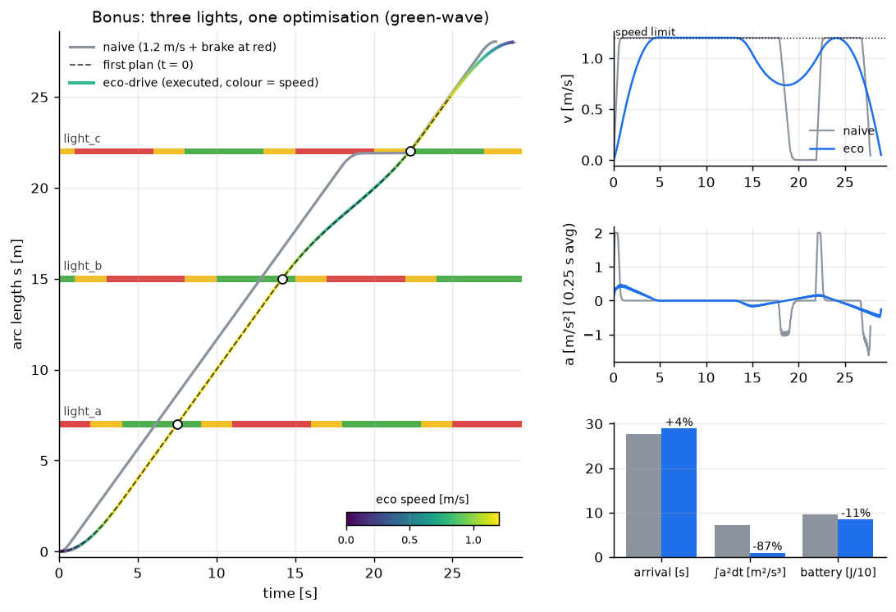
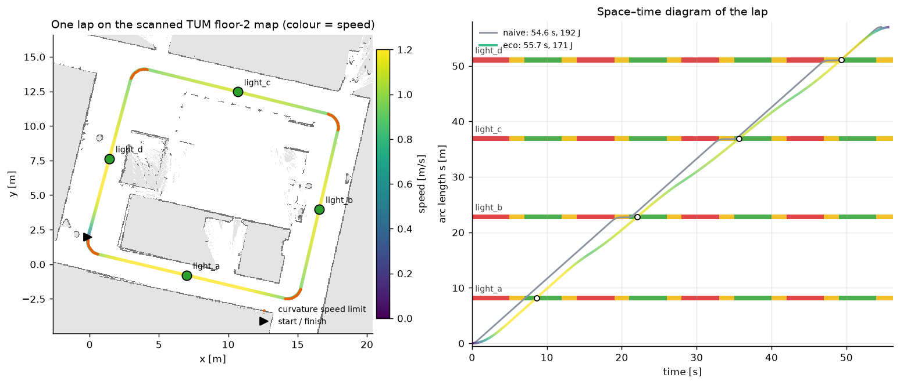

# Eco-Drive: Our Solution

This page explains how we solved [Tutorial 2: Eco-Drive](2_eco_drive.md). The car must never cross the light unless it is green, should reach the end quickly, and should drive gently to save battery, with a speed limit of 1.2 m/s.



*The grey car drives at 1.2 m/s, brakes hard at the red light, waits, and sprints off again. The eco-drive plan rolls up slowly and reaches the light just after it turns green, so it never stops. It arrives 1.1 s later and uses **93 % less ∫a²dt** and **19 % less battery energy**.*

## Results at a glance

| | naive (Tutorial 1 + stop at red) | **eco-drive** |
|---|---|---|
| Red-light violations, 80 random scenarios | 0 (with our guard) | **0** |
| Red-light violations, + timing jitter ±1 s + speed noise | 0 (with our guard) | **0** |
| Battery energy per trip (model) | 53.9 J | **45.8 J (−15 %)** |
| ∫a²dt per trip | 5.77 | **0.74 (−87 %)** |
| Mean trip time | 16.3 s | 18.5 s (+2.2 s) |
| Full lap, 4 lights | 3 stops, 54.6 s, 192 J | **0 stops, 55.7 s, 171 J** |
| Planner solve time, full lap in the ROS sim (median / max) | – | 47 ms / 77 ms, in a separate process |

The naive baseline is the Tutorial 1 controller plus our red-light guard. Without the guard it simply runs the red light.

## Architecture

```text
 odometry ─► RouteProgress (x,y → s) ─┐
 /light_*/state, time_left ─► green_windows()  (guaranteed under jitter)
                                      │
            every 0.5 s ─► EcoDrivePlanner  (CasADi/IPOPT, own process)
                                      │  t ↦ (s, v, a)
                     SpeedTracker: v = v_plan(t+τ) + k·(s_plan − s)
                                      │
                     RedLightGuard  (independent braking envelope)
                                      │
                     lidar safety lock  (from Tutorial 1)
                                      │
     pure pursuit on the filleted route ─► actuation
```

| File | What it does |
|---|---|
| `custom_svea_core/eco_drive/traffic_signal.py` | Light timing model, **guaranteed** green windows |
| `custom_svea_core/eco_drive/route.py` | Filleted route, `s ↔ (x, y)`, curvature, lap unrolling |
| `custom_svea_core/eco_drive/planner.py` | The optimal control problem (below) |
| `custom_svea_core/eco_drive/tracker.py` | Plan tracking law + red-light guard |
| `custom_svea_core/eco_drive/sim.py` | Offline closed-loop simulator (same light and ESC model as the ROS sim) |
| `custom_svea_examples/scripts/eco_drive.py` | ROS 2 node that ties it all together |
| `custom_svea_examples/scripts/eco_drive_analysis.py` | All figures on this page + plotting of recorded runs |
| `custom_svea_core/test/test_eco_drive.py` | 22 unit, property and regression tests |

The `eco_drive` package does not import ROS. That is why we could test, tune and analyse everything on a laptop before touching the car.

## 1. When is the light green? (with certainty)

The light cycles `Rd → YG → Gr → YR` (5 s, 2 s, 5 s, 2 s). It publishes its state and the exact `time_left`. With `alpha > 0` each future red and green phase gets a random length of `nominal ± alpha`. We therefore carry an interval `[earliest, latest]` for every future switching time. The *guaranteed* green window is

$$
\big[\;\text{latest possible green start},\;\; \text{earliest possible green end}\;\big]
$$

Whatever the dice do, the light is green inside it. A property test draws 600 random jitter realisations and checks exactly that. With `alpha = 0` this is just the nominal schedule. With jitter, windows far in the future shrink and eventually vanish. The planner then waits for more information instead of gambling.

## 2. The optimal control problem

We reduce the problem to 1-D along the arc length \(s\), with state \((s, v)\) and input \(a\). The natural approach is a fixed time grid plus a search for the step where \(s\) crosses the light. That search is combinatorial and not smooth. Instead we use the **free-final-time** trick from Problem 2 of the lecture and apply it per *phase*:

```text
  phase 0            phase 1 (commit)    phase 2 (clear)        phase 3
s0 ───────────── s_stop ──────────── s_light ──────────── s_exit ────────── s_goal
                   │ may wait here      τ₁ ∈ green window      τ₂ ≤ green end
```

Every phase ends at a **fixed position** and has a free **duration** \(T_p\), discretised with \(N_p\) steps of \(\Delta t_p = T_p/N_p\). The time at which the car reaches a boundary, \(\tau_p = \sum_{q\le p} T_q\), is then an ordinary decision variable, and *"be at the light while it is green"* becomes a box constraint:

$$
\begin{aligned}
\min_{s,v,a,T}\quad & w_t\,\tau_{\text{end}} \;+\; w_a \sum_k a_k^2\,\Delta t \;+\; w_j \sum_k \frac{(a_{k+1}-a_k)^2}{\Delta t} \;+\; w_m \sum_p \delta_p^2 \\
\text{s.t.}\quad & s_{k+1} = s_k + \Delta t\, v_k + \tfrac12 \Delta t^2 a_k,\qquad v_{k+1} = v_k + \Delta t\, a_k \quad\text{(exact ZOH)}\\
& 0 \le v_k \le \min\!\big(1.2,\ \sqrt{a_{\text{lat}}/|\kappa(s_k)|}\big),\qquad a_{\min} \le a_k \le a_{\max}\\
& s_{\text{end of phase }p} = \text{boundary}_p,\qquad s_0 = s(\text{now}),\ v_0 = v(\text{now})\\
& g_{\text{start}} + m - \delta \;\le\; \tau_{\text{light}} \;\le\; g_{\text{end}} - m + \delta,\qquad \tau_{\text{exit}} \le g_{\text{end}} - m + \delta,\qquad 0\le\delta\le m - m_{\min}\\
& v_k \ge v_{\text{cross}} \;\text{ between stop line and exit (no creeping at the line)}
\end{aligned}
$$

Why this formulation is nice:

* **The crossing time is exact, not only exact at grid points.** \(v \ge 0\) at the nodes and \(a\) is piecewise constant, so \(s(t)\) is monotone. The car is therefore *strictly before* the light for all \(t < \tau_{\text{light}}\). The test suite checks this on a 2000-point dense grid.
* **No integers.** The only discrete choice is *which* green window to use per light. We enumerate the reachable ones, solve one NLP per candidate and keep the cheapest. The tutorial asks exactly this question: "is it sometimes cheaper to wait for the next green?" See the Pareto plot below.
* **Fast, with exact pruning.** Each NLP is built once per *structure* and re-solved with CasADi parameters (state, boundary positions, windows, speed-limit table). Every term of the objective is non-negative, so a candidate's cost is at least \(w_t \times\) its earliest possible arrival. We check reachability light by light, sort the candidates by that bound, and skip any whose bound cannot beat the best plan found so far. This needs about 1.3 NLP solves per plan instead of about 7, and gives bit-for-bit the same plans as solving every candidate (checked on 304 lap situations). In the ROS simulation of a full lap, planning went from about 1 s to **47 ms median (77 ms worst)**. The stale plans had caused the guard to step in 36 times; after the change it never did.
* **The whole car clears the light.** Entering on green is not enough. The rear of the car (`clear_dist` = 0.6 m) must be past the light before green ends.
* **Soft margin, hard floor.** We prefer a 0.3 s time margin, but only 0.1 s is hard. During testing we found that without the soft part, a small tracking lag made the next replan infeasible. The planner then gave up a window it could easily make and waited a whole cycle, which is a classic recursive-feasibility problem. The soft margin, together with raising the hard acceleration cap from 0.5 to 1 m/s² (the penalty keeps it gentle anyway), cut the mean delay in the Monte Carlo study from +4.2 s to +2.0 s, with the same energy saving.
* **Soft curvature limit.** The 1.2 m/s limit is hard, but the corner limit is soft with a heavy penalty. Otherwise a car that is already slightly too fast when it reaches a corner (its measured speed is fixed at node 0) makes the NLP infeasible. Driving the real node around the lap in our mock-ROS test exposed this.
* **Hold fallback.** If no window is reachable (light unknown, stale topic, or not started yet), a *hold* plan stops smoothly at the stop line.

## 3. Choosing the weights (time vs. energy)



We fix \(w_t = 1\) and sweep the energy weight \(w_a\). Up to about \(w_a \approx 1\), extra time buys almost nothing. Between 1 and 12 every extra second saves a lot of ∫a². Beyond about \(w_a \approx 40\) the optimum **jumps to the next green window**: arriving 15 s later is "cheaper" than accelerating at all, which no sensible driver wants. We chose **\(w_a = 4\)**, at the knee of the curve. It arrives 2 s later than the fastest plan and has 63 % less ∫a².

The black squares show the alternative from the task description: **hard-capping** \(|a|\) instead of penalising it. A cap is a much worse deal. It cuts the peaks, but the profile stays bang-bang, and with tight caps it misses the window entirely (caps 0.2 and 0.15). So we keep \(a_{\max} = 1.0\) m/s² as a physical/comfort limit and let the penalty do the eco part. In the physical battery model the curve flattens even earlier. Most of the remaining energy goes into rolling resistance, which is spent anyway.

## 4. Tracking the plan, and a guard that does not trust it

**Tracker.** The ESC behaves like a first-order lag (τ ≈ 0.1 s), so we feed forward the plan speed *0.1 s ahead* and add position feedback so the car does not drift away from the planned crossing time:

$$
v_{\text{cmd}}(t) = v_{\text{plan}}(t + 0.1) + 0.8\,\big(s_{\text{plan}}(t) - s\big)
$$

**Replanning from the reference.** The first run in the real ROS simulation exposed a problem the offline sim could not show. `sim_svea.py` only reaches about 1/1.27 of the commanded speed, and it zeroes the command for a moment after every full second (its timeout compares whole seconds). The car therefore lagged the plan by 0.1–0.2 m/s. Every replan started from that lagging measured state, so the plan slid later and later until it missed a green it could easily have made: 41.8 s instead of 18 s. The fix is standard practice in automotive planners. While the car is within 0.4 m / 0.3 m/s of the plan, the next plan starts from the *reference* state, not the measured one, so the lag cannot hide. An integral term on the speed error then learns the actuator gain (it ends up commanding ~1.55 m/s to get a real 1.2 m/s). Both simulator flaws are now part of the offline sim, and a regression test covers them. The same run now takes 21.6 s and never stops.

**Guard.** Correctness matters more than elegance, so an independent layer checks every tick: *"if I keep this speed, will I be inside the intersection only during a guaranteed-green window?"* If not, it caps the command with a braking envelope \(v \le \sqrt{2b\,d}\), corrected for actuation lag. Between the stop line and the light it holds the car at zero. In all 160 eco-drive runs of the Monte Carlo study the guard never had to step in. It exists for stale topics, solver failures or bad localization. The simulator also caught a bug in an early version of the guard itself: a car that stopped 3 cm past the margin line was treated as "already committed" and released on red.

**Steering** is still the Tutorial 1 `PurePursuitController`. It now follows a look-ahead point on the filleted route, which supports laps. The **lidar safety lock** from Tutorial 1 is kept on top of everything.

## 5. Robustness: 320 randomized runs



We used 80 random scenarios (light position 4–11 m, random phase). Each was run with nominal timing, and again with ±1 s jitter on the light plus speed-command noise (σ = 0.05 m/s). Results:

* **No violations.** In the stress test the guaranteed windows shrink, but the planner simply uses them.
* **15 % battery saving** on average. Every single scenario is below the diagonal.
* Trips take +2.2 s on average. In a handful of scenarios (the cluster at ≈ 24 s) the naive car squeezes through a green that eco-drive (capped at 1 m/s², and requiring the whole car to clear the light with a margin) cannot make. It then waits for the next green. That is the deliberate price of the margins.

## 6. Bonus: several lights and full laps



The phase formulation handles several lights without any change. Every light adds a stop / commit / clear phase triple, and the candidates are combinations of windows. With three lights the planner finds a **green wave**: it slows down slightly near 15 s so that it also arrives at the third light on green.



On a full lap of the TUM floor-2 map (the route from Tutorial 1, four lights), the route corners are rounded with 1 m fillets. The planner gets a curvature speed limit \(\sqrt{a_{\text{lat}}/|\kappa|}\) (orange). Closed routes use an *unrolled* arc length, so "the next light" stays well defined across the finish line. The naive car stops three times. Eco-drive gets through all four lights without stopping and arrives only 1 s later.

## How to run it

```bash
# build (inside the container)
colcon build --symlink-install && source install/setup.bash

# Task 1: one light on the first straight
ros2 launch custom_svea_examples eco_drive.launch.py

# Bonus: lap with four lights / stress test with jittery lights / other trade-offs
ros2 launch custom_svea_examples eco_drive.launch.py lap:=true
ros2 launch custom_svea_examples eco_drive.launch.py alpha:=0.5
ros2 launch custom_svea_examples eco_drive.launch.py w_acc:=20.0

# real car
ros2 launch custom_svea_examples eco_drive.launch.py is_sim:=false
```

Open Foxglove and load `foxglove/Eco Drive.json`. It shows the map with the plan coloured by speed, a translucent *ghost car* marking where the plan wants you to be right now, stop lines coloured by light state, live speed and progress plots, the light timeline and the energy used.

Every run is logged to `~/eco_drive_logs/*.csv`. Plot a run, including on the real car, with:

```bash
python3 src/custom_svea_examples/scripts/eco_drive_analysis.py log ~/eco_drive_logs/eco_drive_<time>.csv
```

Regenerate every figure on this page (no ROS needed, only `numpy`, `matplotlib` and `casadi`):

```bash
python3 src/custom_svea_examples/scripts/eco_drive_analysis.py all
python3 -m pytest src/custom_svea_core/test/test_eco_drive.py -q
```

### Real-car checklist

* The light constants (`red_time`, `yellow_time`, `green_time`, `alpha`) must match `traffic_light.py`. The launch file passes them to both nodes.
* The lights start their cycle when the planner has its first plan (`wait_for_start`), so every run starts the same way.
* The velocity sign is inverted on the real car (same as Tutorial 1).
* Start with `v_max:=0.6` and the RC remote in hand. The guard and the lidar lock are no replacement for the emergency stop.
