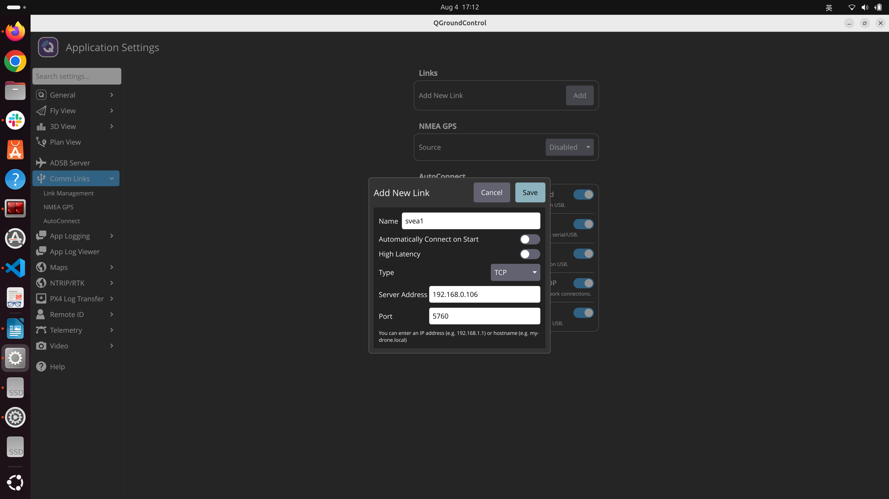
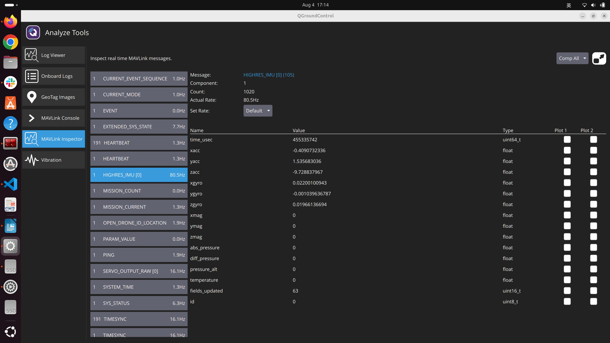

# QGroundControl

QGroundControl (QGC) connects to the PX4 board on the SVEA through MAVROS. You can use it to inspect the raw MAVLink data (IMU, RC, wheel encoders, ...) coming from the car.

## 1. Install

Download and install QGroundControl on your laptop by following the [official guide](https://docs.qgroundcontrol.com/Stable_V5.0/en/qgc-user-guide/getting_started/download_and_install.html).

## 2. Start MAVROS on the SVEA

SSH into the car and launch the low-level interface:
```bash
util/run
ros2 launch svea_core lli.xml
```
QGC connects through MAVROS, so keep this running while you use QGC.

!!! note

    To inspect the wheel data in QGC, `send_raw` must be `true` in `src/svea_core/params/mavros.yaml`. This is already set in this repository.

## 3. Add a link to the car

In QGC, click the **Q** icon in the top left, then go to **Application Settings → Comm Links → Add New Link**. Fill in:

- **Name**: any name, e.g. `svea1`
- **Type**: `TCP`
- **Server Address**: the IP address of the car (or its hostname, e.g. `svea1.local`)
- **Port**: `5760`



Click **Save**, then select the link in the list and click **Connect**. If you get "Connection refused", check that `lli.xml` is running and that the IP address is correct.

## 4. Inspect data

Click **Q → Analyze Tools → MAVLink Inspector**. The left column lists every MAVLink message the car sends, with its rate. Click a message to see its fields, e.g. `HIGHRES_IMU` for the IMU or `WHEEL_DISTANCE` for the wheel encoders. Tick **Plot 1** or **Plot 2** next to a field to plot it.



If `WHEEL_DISTANCE` is missing, the encoder data is not reaching PX4. Open **Analyze Tools → MAVLink Console** and run:
```
svea_peripheral_mcu status
listener wheel_encoders
```
`bytes` in the status output should keep increasing. If it stays at 0, check the UART wire between the ESP32 and the PX4 board (see [Troubleshooting](1_2_tutorial_lidar_map.md#troubleshooting) in the Lidar Map tutorial).

!!! warning

    QGC automatically connects to USB serial devices. Close QGC before you flash or open a serial monitor on the ESP32, otherwise the port is busy.
